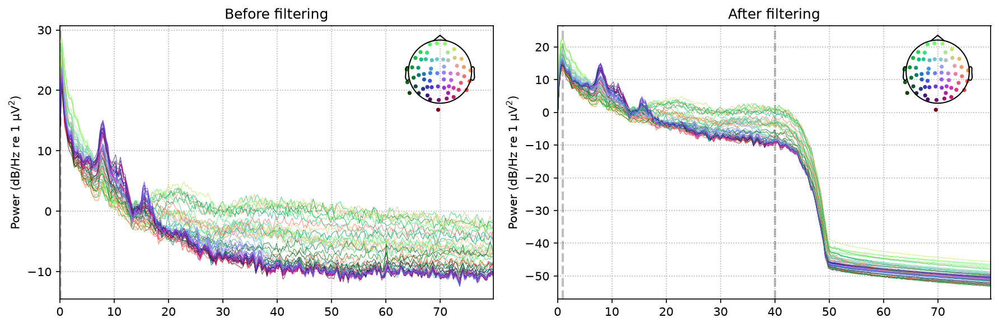
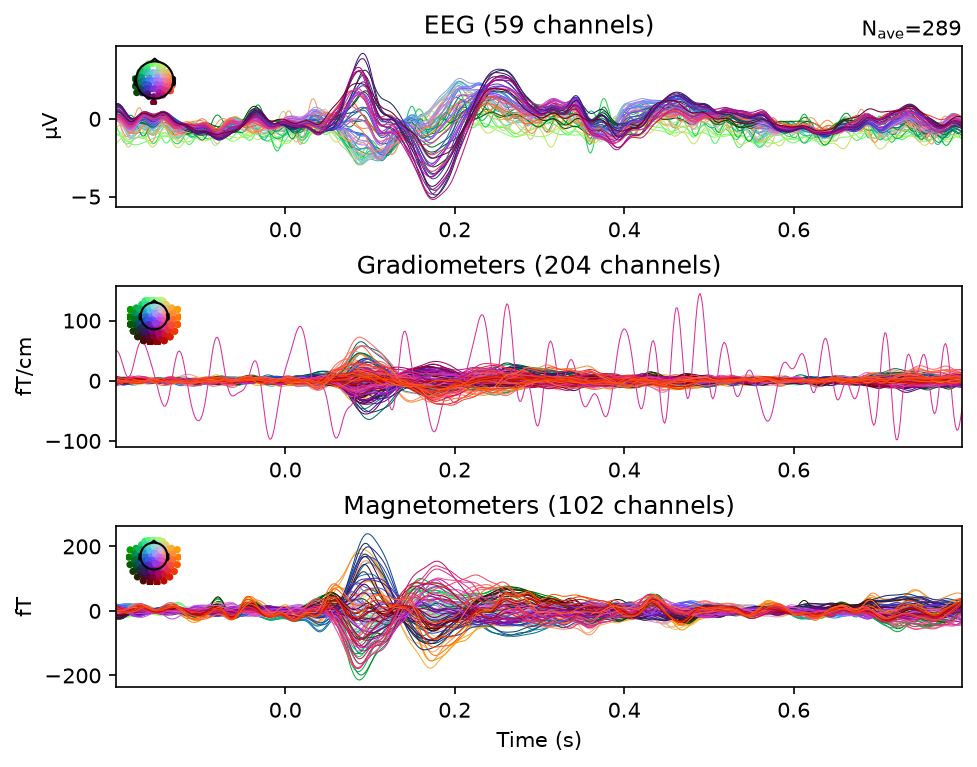
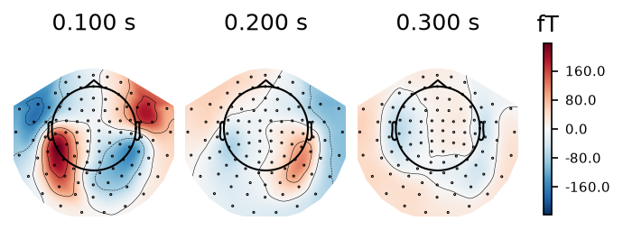
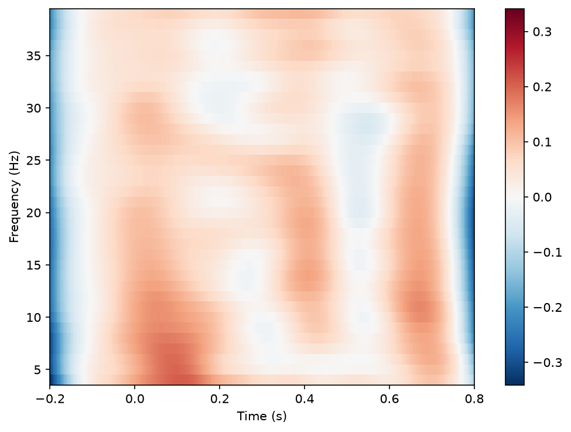
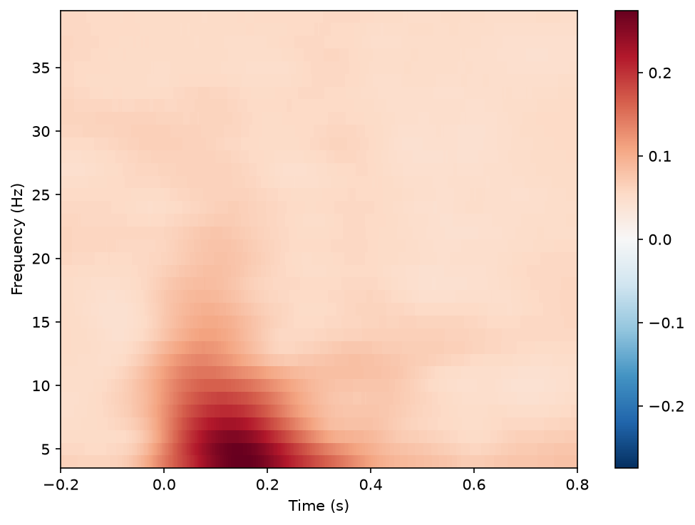

# EEG Preprocessing & Analysis Pipeline


Built by Pawan Keshav Saravanan, an undergraduate, as self-directed
preparation for BCI/neurotech research — an end-to-end EEG signal-processing pipeline in
MNE-Python — raw data loading through filtering, epoching, artifact rejection, ICA,
ERP/time-frequency analysis, and motor-imagery classification. Built as a portfolio project
demonstrating the core preprocessing and analysis skills used in BCI/neurotech research and
engineering roles.

## Contents
- [What This Is](#what-this-is-and-why-it-exists)
- [Example Output](#example-output)
- [Pipeline Modules](#pipeline-modules)
- [Repository Structure](#repository-structure)
- [Setup](#setup)
- [Running the Pipeline](#running-the-pipeline)
- [Dataset](#dataset)
- [Testing](#testing)
- [Results Walkthrough](#results-walkthrough)
- [How This Was Built](#how-this-was-built)
- [What I Learned](#what-i-learned)

## What this is and why it exists

This project was built module by module (M0 through M9), each stage committed and merged
independently, to demonstrate real, incremental engineering work rather than one large
uncommitted dump of code. Every processing parameter — filter cutoffs, epoch windows, ICA
settings, classifier folds — is driven by `config.yaml`, not hardcoded across files, so the
entire pipeline can be re-run against a different dataset or parameter set by editing one file.

## Example Output



Power spectral density of the MNE sample dataset's EEG channels, before and after the
pipeline's notch + bandpass filter stage. The 1–40 Hz passband edges are visible as sharp
transitions, and power outside that band (including 60 Hz line noise) drops off steeply once
filtered.

## Pipeline Modules

- **M0 — Scaffold:** project structure, `config.yaml`, and `pipeline.py` orchestrator skeleton.
- **M1 — Data Loading (`src/preprocessing/loader.py`):** loads raw EEG from `.fif` or `.edf`
  files into an MNE `Raw` object; the single entry point every downstream module builds on.
- **M2 — Filtering (`src/preprocessing/filter.py`):** removes power-line hum (notch filter) and
  out-of-band drift/noise (bandpass filter) before any further processing.
- **M3 — Epoching (`src/preprocessing/epoching.py`):** cuts the continuous filtered signal into
  short, event-locked trial windows.
- **M4 — Artifact Rejection (`src/preprocessing/artifacts.py`):** discards whole trials whose
  peak-to-peak amplitude exceeds a physically-implausible threshold for real cortical signal.
- **M5 — ICA (`src/preprocessing/ica.py`):** separates statistically independent signal sources
  and surgically removes eye-blink components (auto-detected via correlation with a real EOG
  channel) without discarding the whole trial.
- **M6 — ERP Analysis (`src/analysis/features.py`):** averages trials to reveal stimulus-locked
  components, and compares conditions against each other rather than only a single grand average.
- **M7 — Time-Frequency Analysis (`src/analysis/features.py`):** computes power across time and
  frequency (Morlet wavelet TFR) to capture non-phase-locked effects averaging alone would cancel
  out, such as alpha suppression.
- **M8 — Inter-Trial Coherence (`src/analysis/features.py`):** measures phase consistency across
  trials, independent of power — a distinct question from M7's power analysis.
- **M9 — Classification (`src/analysis/classifier.py`):** extracts mu/beta band-power features
  per trial and cross-validates an LDA decoder — the motor-imagery / BCI-relevant capstone of
  the pipeline.

## Repository Structure

```
eeg-project/
├── pipeline.py                   # orchestrator -- reads config.yaml, runs full pipeline
├── config.yaml                   # single source of truth for all parameters
├── src/
│   ├── preprocessing/
│   │   ├── loader.py             # M1 -- load_raw, inspect_raw
│   │   ├── filter.py             # M2 -- apply_filters, save_processed
│   │   ├── epoching.py           # M3 -- make_epochs
│   │   ├── artifacts.py          # M4 -- mark_bad_channels, reject_by_amplitude, log_rejection
│   │   └── ica.py                # M5 -- fit_ica, auto_detect_eog, apply_ica
│   ├── analysis/
│   │   ├── features.py           # M6-M8 -- band_power, compute_erp, compare_conditions,
│   │   │                         #          compute_tfr, compute_itc
│   │   └── classifier.py         # M9 -- extract_band_power_features, decode_with_lda
│   └── visualization/
│       └── plot.py               # plot_erp, plot_topomap, plot_psd, plot_tfr, plot_itc
├── notebooks/                     # one exploratory notebook per milestone (M1-M9)
├── tests/                          # pytest suite, mirrors src/
├── data/                            # gitignored -- local raw/processed EEG data
└── results/
    ├── figures/                      # generated + selectively committed portfolio figures
    └── reports/
```

## Setup

```bash
python -m venv .venv
.venv/Scripts/activate        # .venv/bin/activate on macOS/Linux
pip install -e ".[dev]"
```

Dependencies are declared in `pyproject.toml` (single source of truth); `requirements.txt` just
points back to it.

## Running the pipeline

No raw data ships with this repo (`data/` is gitignored) -- fetch MNE's bundled sample dataset
first, which downloads once and prints the exact file path to use below:

```bash
python -c "import mne; print(mne.datasets.sample.data_path() / 'MEG' / 'sample' / 'sample_audvis_raw.fif')"
```

`pipeline.py` chains preprocessing (load → filter → epoch → reject → ICA) → analysis (band
power, ERP, condition comparison, time-frequency, inter-trial coherence) → classification
(band-power features, cross-validated LDA) → visualization for one subject, and is resumable: it
skips the preprocessing stage when its output is already up to date with the current config, and
writes a JSON provenance sidecar next to each processed file recording exactly what parameters
produced it.

```bash
# Single subject -- --file is the path printed by the command above
python pipeline.py --subject sub-01 --file path/to/sample_audvis_raw.fif --bad-channels "EEG 053"

# Recompute even if cached output looks up to date
python pipeline.py --subject sub-01 --file path/to/sample_audvis_raw.fif --bad-channels "EEG 053" --force

# Batch mode: iterate config.yaml's `subjects` list, resolving each subject's file
# under paths.raw_data as "{subject}_raw.fif"
python pipeline.py
```

Pipeline parameters (filter cutoffs, epoch window, frequency bands, ICA settings, classifier
folds, paths) live in `config.yaml`.

## Dataset

Primary development dataset for M1 through M8: the MNE sample auditory/visual dataset (1
subject, EEG+MEG combined, ~600 Hz, ~277 s, ~320 events across auditory/visual left/right
conditions). The recording has 60 EEG, 1 EOG, 204 gradiometer, 102 magnetometer and 9 stimulus
channels, and the pipeline keeps the MEG channels (see [Known Limitations](#known-limitations)).

M9's motor-imagery classification is built for the [PhysioNet EEGBCI](https://physionet.org/content/eegmmidb/1.0.0/)
dataset — imagined left/right fist movement runs (4, 8, 12), the condition structure the mu/beta
band-power features and LDA decoder are designed for. `group_decode_study.py` runs it on 15
subjects (two classes, so chance is 50%): mean cross-validated accuracy 0.550 without cleaning
and 0.532 with ICA cleaning, paired Wilcoxon p = 0.327, a null result at this sample size. Full
report: [`results/reports/group_decode_study.md`](results/reports/group_decode_study.md).
Running `pipeline.py` on the sample dataset still executes the classifier end-to-end, but on
auditory/visual conditions rather than motor imagery (see [Classification](#6-classification)).

## Testing

```bash
pytest              # fast suite (synthetic EEG data, no downloads)
pytest -m slow       # add the end-to-end test against the real MNE sample dataset
```

## Results Walkthrough

A single confirmed end-to-end run (`sub-01`, MNE sample dataset) through every pipeline stage,
in order:

### 1. Filtering


The notch + bandpass stage removes power-line hum and out-of-band drift — the 1–40 Hz passband
edges are visible as sharp transitions, with power outside that range dropping off steeply.

### 2. Cleaned epochs (artifact rejection + ICA)

320 events were found on the stimulus channel; amplitude rejection (150 µV peak-to-peak
threshold) dropped 31 of them (9.7%) as gross whole-trial contamination, leaving 289 epochs.
ICA was then fit on the survivors and automatically identified two components correlating with
the real EOG channel, which were removed — a targeted correction rather than discarding those
trials outright.

### 3. Event-related potential




The averaged EEG response (top panel of the waveform plot, N = 289 epochs) shows a clear early
deflection around 100 ms post-stimulus and a larger, broader deflection between roughly
150–250 ms. This run reports only the timing and size of these deflections; it does not test
what process produces them. One gradiometer trace in the MEG panel oscillates across the whole
epoch; it has not been identified or marked bad (only `EEG 053` is). The topography figure is a
**magnetometer** map (unit fT), because MNE's `plot_topomap` defaults to the first channel type
present; at 0.1 s the field is concentrated over the left-frontal sensors and changes by
0.2–0.3 s.

### 4. Time-frequency power (TFR)



Power relative to the pre-stimulus baseline (log-ratio), across 4–39 Hz, for one channel:
`MEG 0113`, a gradiometer (set by `analysis.tfr_plot_channel` in `config.yaml`). The strongest,
most consistent increase sits in the low frequencies (below ~15 Hz) shortly after stimulus
onset — this captures effects that a phase-locked average (the ERP above) would partly wash
out, since power changes don't require every trial to share the exact same phase.

### 5. Inter-trial phase coherence (ITC)



Phase consistency across trials, independent of amplitude. The figure is the mean over all
365 channels (EEG, EOG, gradiometers and magnetometers together), not a single sensor. There's
a strong band of high coherence in the same low-frequency, early-latency region (roughly
0–0.3 s, below ~15 Hz) — the signal isn't just larger in that window, its phase is also
consistent from trial to trial there, which is a different (and complementary) claim than the
power result alone makes.

### 6. Classification

Cross-validated (5-fold) LDA accuracy on this run is **31.86%**, with a standard deviation of
**5.12 percentage points across the 5 folds** (population SD). Per-fold values are not logged by
the pipeline. Features are mu/beta (8–30 Hz) band power per channel, including the MEG
channels, decoding all six of the sample dataset's event codes (auditory/visual left/right,
smiley, button-press; 58, 69, 68, 65, 14 and 15 epochs). Two reference levels: uniform chance
for six classes is 16.67%, and always guessing the largest class (69 of 289) gives 23.88%. The
mean is above both on this run. These are auditory/visual conditions, not motor imagery, and this
run does not test what the features pick up; unequal class sizes and the inclusion of MEG
channels both affect the number. The motor-imagery result is in the [Dataset](#dataset) section.

### Known Limitations

Artifact rejection in this pipeline is not equally verifiable across artifact types. Eye-blink
components have a genuine independent check: a real recorded EOG channel to correlate ICA
components against. Cardiac and muscle components have no equivalent — ICA here is fitted on
the EEG channels only (`picks="eeg"`), and MNE's "synthesize an ECG reference from MEG
channels" fallback does not apply to an EEG-only decomposition (confirmed directly: attempting
it raises `ValueError: Generating an artificial ECG channel can only be done for MEG data`).
Cardiac/muscle component decisions rely on ICA's own diagnostics (topography, spectrum) alone,
with no ground-truth signal to verify against.

Only the ICA step is restricted to EEG. The other stages keep all channel types, so the
classifier features and the ITC figure include the 306 MEG channels, the TFR figure is a
gradiometer, and the topography is magnetometers. The MEG channels are not ICA-cleaned. Restricting
the whole pipeline to EEG would change every downstream number and has not been done.

## How this was built

The code was built with AI coding assistance (Claude Code) and is reviewed week by week by
Pawan Keshav Saravanan.

## What I Learned

- **Averaging is doing real statistical work, not just "taking the mean."** A single trial's
  EEG is unreadable noise; a few hundred averaged trials reveal a clean, structured waveform.
  The mechanism is a signal-to-noise argument, not magic: a true stimulus-locked response
  survives averaging intact because it's identical on every trial, while background noise is
  uncorrelated trial-to-trial and shrinks toward zero roughly as 1/√N.

- **Amplitude rejection and ICA solve genuinely different problems, and the order between
  them matters.** Amplitude thresholding is a blunt, whole-trial tool — it can only keep or
  discard an entire epoch. ICA can surgically remove one specific artifact source from an
  otherwise-usable trial. Running rejection first isn't arbitrary ordering: it removes the
  worst whole-trial contamination before ICA has to spend its decomposition fitting components
  to data that was always going to be thrown away.

- **Power and phase-consistency are different claims about the same effect, and conflating
  them would be a mistake.** The TFR and ITC results above look similar at a glance (both
  highlight the same early, low-frequency window) but they answer different questions — power
  says the signal got bigger there; coherence says the trials are agreeing on timing there.
  A real effect usually shows up in both, which is itself informative.

- **A config-driven pipeline is a discipline that has to be actively maintained, not a
  one-time setup.** It was genuinely tempting more than once to add a new parameter directly
  into a function call rather than route it through `config.yaml` — every time that temptation
  won, it would have quietly broken the property that every processing decision this pipeline
  makes is visible and changeable in one place.
